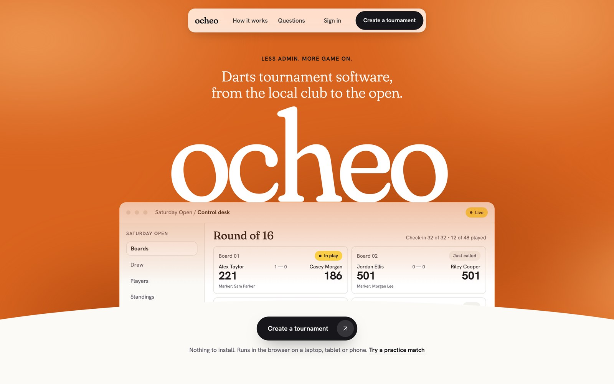
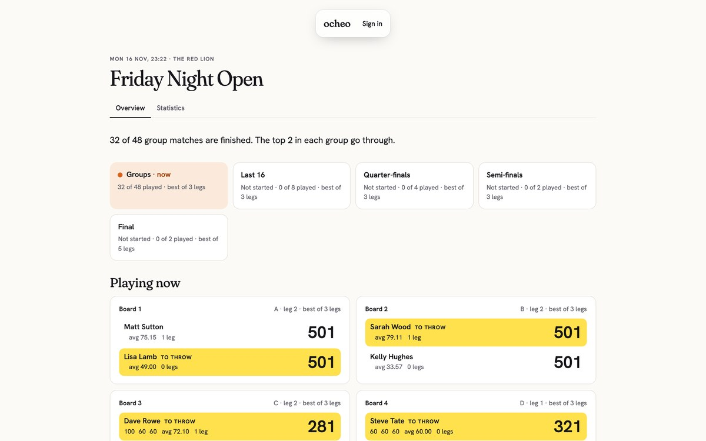
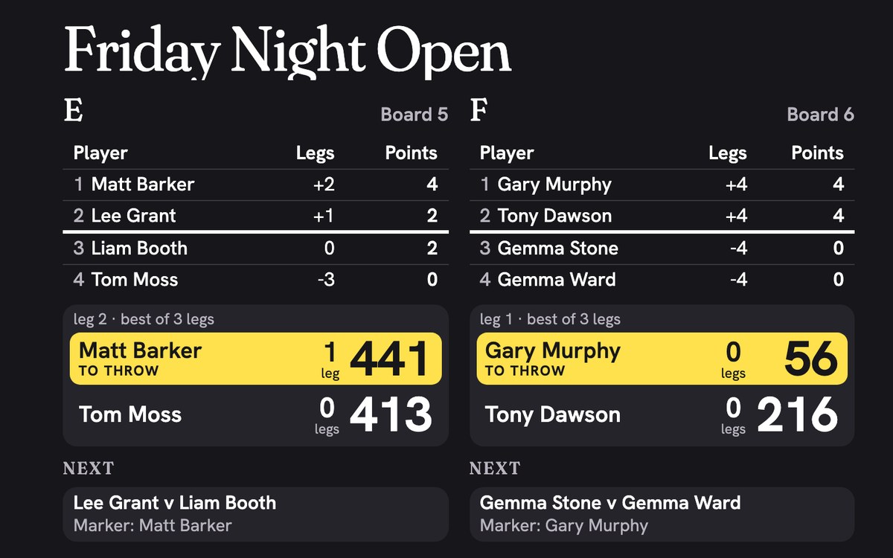
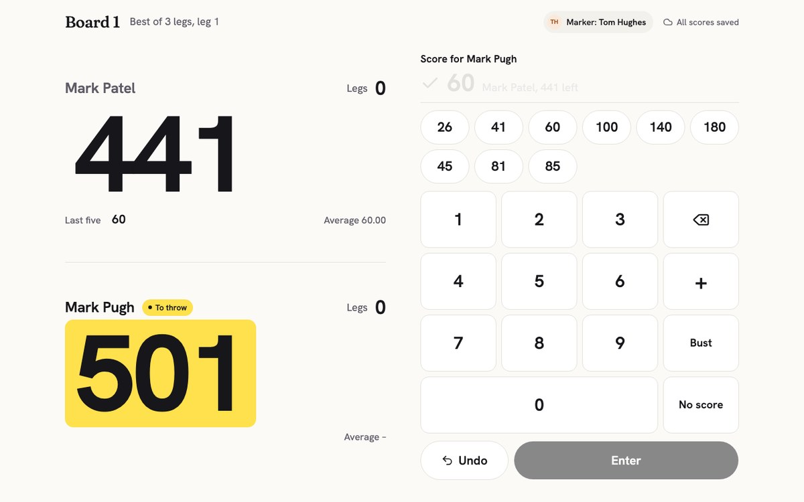
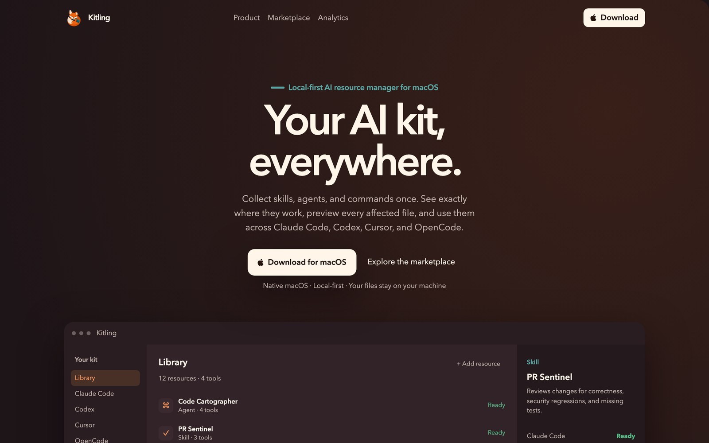
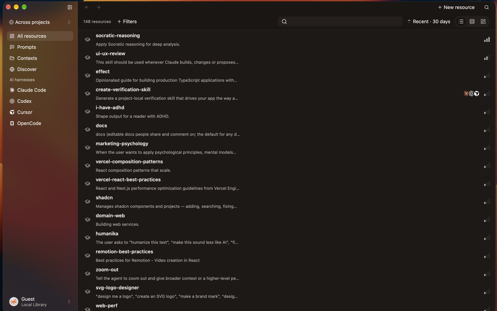
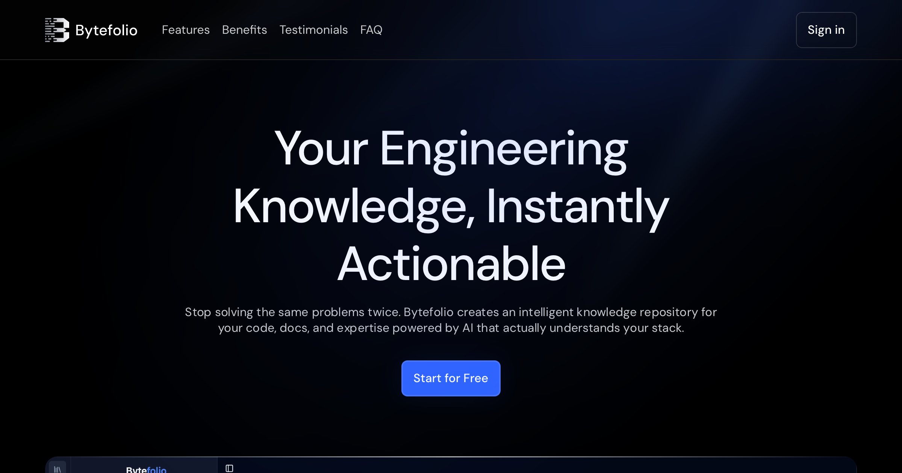
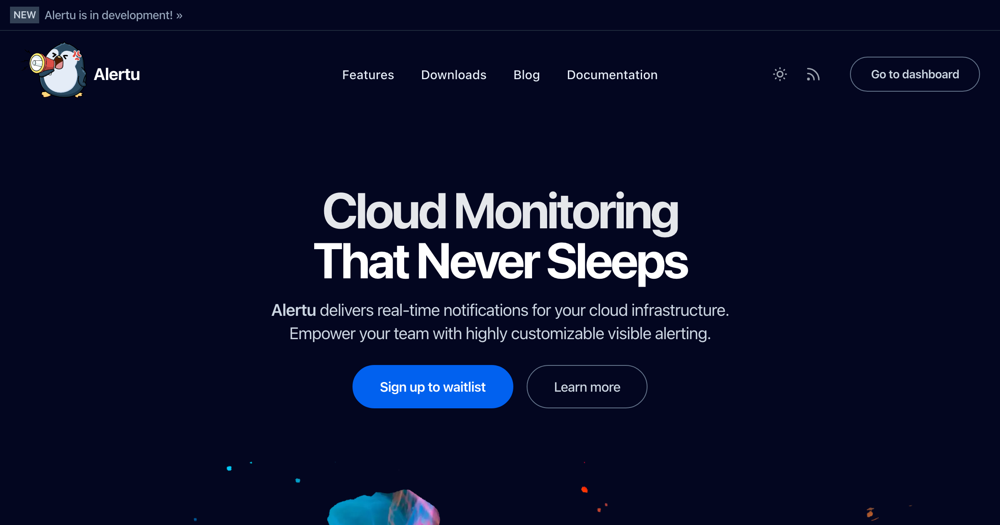
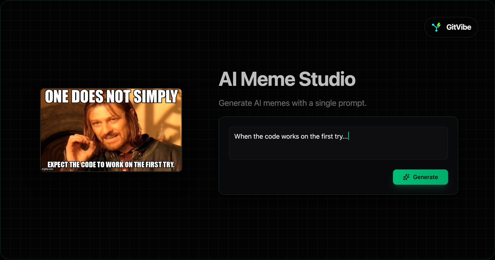

  

   
  
  <h3>
    Full-Stack Engineer
  </h3>
  
  

    Building innovative products with AI and aspiring founder 
    Committed to pushing a meaningful git commit every day. 
    <i>Interests: Computer Science • Building products and computers • AI • 3D printing • Gym • Gaming (OSRS, Age of Empires 2 DE, PUBG, CSGO) </i>
  

   

  

    
  

  <h2>Building now</h2>

  <h3>Ocheo</h3>
  

    Runs a darts tournament from entry to final: the draw, live scoring at every board and a venue TV. 
    React 19 · TanStack Router &amp; Query · Effect · Drizzle · Cloudflare Workers &amp; D1
  

  
  

    
    
    
  

   

  <h3>Kitling</h3>
  

    A native macOS app that keeps one library of skills, prompts and contexts in sync across your AI coding tools. 
    Rust · GPUI
  

  
  

    
  

  <h2>Previously</h2>

  

    
    
    
  

  <h2>My Tech Stack</h2>
  
  

